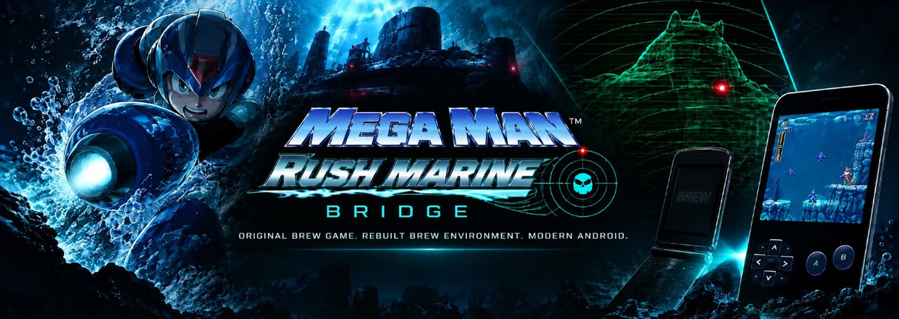

# Rush Marine Bridge

Play the preserved **Mega Man: Rush Marine** mobile game on modern Android with original BREW gameplay, audio, and touchscreen controls.

## Quick Start

1. Open the [v0.1.2 Release](https://github.com/Wakkatobakka/Rush-Marine-Bridge/releases/tag/v0.1.2).
2. Download and install `Rush_Marine_Bridge_v0.1.2.apk` on your Android device.
3. Download the compatible **Mega Man: Rush Marine** game ZIP using the link below.
4. Open Rush Marine Bridge and tap **IMPORT RUSH MARINE ZIP**.
5. Select your downloaded game ZIP without extracting it.
6. Once verified, tap **ENTER RUSH MARINE** and play.

**Note:** Original game data is not included. You'll need the compatible English BREW 1.1.11 version.

## Getting the Game Files

The original **Mega Man: Rush Marine** mobile game can be found here:

[Download Mega Man: Rush Marine – My Abandonware](https://www.myabandonware.com/game/mega-man-rush-marine-vw9)

Look for the **English BREW 1.1.11** release.

Keep the downloaded game ZIP intact. Rush Marine Bridge can import it directly.

### Already Have Extracted Files?

The optional `Rush_Marine_Game_Data_Zip_Helper_v0.1.2.zip` is available on the [Releases page](https://github.com/Wakkatobakka/Rush-Marine-Bridge/releases/tag/v0.1.2).

Use it to prepare extracted game files into a compatible import ZIP.

## What Works

- Original Mega Man: Rush Marine gameplay
- Original 128×160 BREW game presentation
- Game audio
- Touchscreen movement and action controls
- Original phone-key input support
- Local game-data import
- Offline gameplay after importing
- In-app diagnostics and report export

## Known Limitations

**Saving progress across fresh app launches is not finished yet.**

Rush Marine Bridge is still a pre-release. Additional issues may appear in portions of the game that haven't been fully tested.

## Compatibility

Rush Marine Bridge v0.1.2 supports **Android 8.0 or newer**.

Tested on a **Samsung Galaxy S25 Ultra running Android 16**.

Compatibility with other Android devices and versions may vary.

## About This Project

Rush Marine Bridge is an independent compatibility project created to make the preserved BREW version of Mega Man: Rush Marine playable on modern Android devices.

This is my first public BREW bridge.

Rush Marine Bridge is not affiliated with or endorsed by Capcom or Qualcomm.

Mega Man and related game content belong to their respective rights holders.

Third-party acknowledgments are available in [THIRD-PARTY-NOTICES.txt](THIRD-PARTY-NOTICES.txt).
